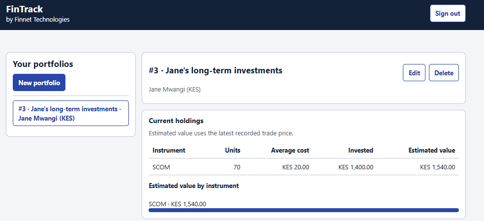

# FinTrack

A portfolio and transaction tracker built for the Finnet technical assessment.

## Live demo

- [FinTrack web app](https://fintrack-6y5h.onrender.com/)
- [Swagger API documentation](https://fintrack-6y5h.onrender.com/docs)

### Portfolio holdings

### Transaction history

