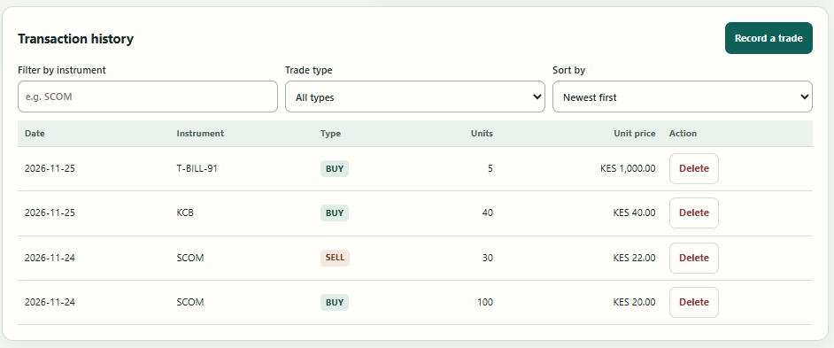

# FinTrack

FinTrack is a portfolio and transaction tracker built for the Finnet Technologies technical assessment. An analyst can create client portfolios, record buys and sells, and see current holdings, their estimated value, and how that value is distributed across instruments.

## Live demo

- [FinTrack web app](https://fintrack-6y5h.onrender.com/)
- [Swagger API documentation](https://fintrack-6y5h.onrender.com/docs)
- [GitHub repository](https://github.com/BILDADMOSES/FinTrack)

The demo account includes Jane’s KES portfolio and Alex’s USD portfolio. Demo credentials are provided with the submission.

## Screenshots

### Portfolio overview


### Transaction history



## Stack and architecture

| Layer | Technology | Purpose |
|---|---|---|
| Frontend | HTML, CSS, and JavaScript | Renders forms, holdings, trade history, and the allocation chart. |
| API | Python, FastAPI, and Uvicorn | Serves the web page and API, validates requests, and calculates holdings. |
| Database | PostgreSQL on Neon, accessed through Psycopg | Stores analysts, portfolios, and trades. |
| Authentication | Argon2 password hashing and JWT access tokens | Verifies sign-in and identifies the analyst making each request. |
| Tooling and hosting | `uv`, GitHub, and Render | Locks Python dependencies, tracks changes, and deploys the app. |

FastAPI serves the browser interface and the API from one web service. The browser sends requests to FastAPI, FastAPI reads and writes records in PostgreSQL, and the browser displays the results.

## Run locally

1. Install `uv` and clone this repository.
2. Create a PostgreSQL database and run `backend/schema.sql` in it.
3. From the repository root, run the commands below in Bash. Paste your PostgreSQL connection URL when prompted.

   ```bash
   uv sync --locked
   read -rsp 'PostgreSQL connection URL: ' DATABASE_URL
   echo
   export DATABASE_URL
   export FINTRACK_JWT_SECRET="$(uv run --locked python -c 'import secrets; print(secrets.token_hex(32))')"
   uv run --locked python -m uvicorn backend.main:app --port 8001
   ```

4. Open [FinTrack](http://127.0.0.1:8001/) or [Swagger](http://127.0.0.1:8001/docs).

`.env.example` lists the required settings. Keep real credentials in your environment or hosting dashboard.

## Deployment

Render deploys the `main` branch as a Python web service. Set `DATABASE_URL` and `FINTRACK_JWT_SECRET` in the service’s environment settings.

- Build command: `uv sync --locked`
- Start command: `uv run --locked python -m uvicorn backend.main:app --host 0.0.0.0 --port $PORT`
- Health endpoint: `/api/health`

## Manual verification

1. Register and sign in. Create a KES portfolio.
2. Record a buy of 100 SCOM units at KES 20 and a later sale of 30 units at KES 22.
3. Confirm the portfolio shows 70 units, KES 1,400 in holdings cost, and KES 1,540 in estimated value.
4. Try selling 80 more units. The API should return `409 Conflict`. Then try deleting the original buy. The API should also reject that change because the later sale depends on it.

## Calculations and assumptions

- Each portfolio belongs to one analyst and uses KES or USD.
- Holdings cost uses weighted-average cost. After buying 100 SCOM units at KES 20 and selling 30, the remaining 70 units have a cost of KES 1,400.
- Estimated value uses each instrument’s latest recorded trade price. At KES 22 per unit, those 70 SCOM units have an estimated value of KES 1,540.
- Allocation is calculated from estimated value. For Jane’s demo portfolio, T-BILL-91 accounts for KES 5,000 of KES 8,140, or 61.4%.

## AI assistance

I used ChatGPT to help plan the application, draft and revise code, and troubleshoot issues. I tested the API in Swagger and verified the application in the browser.